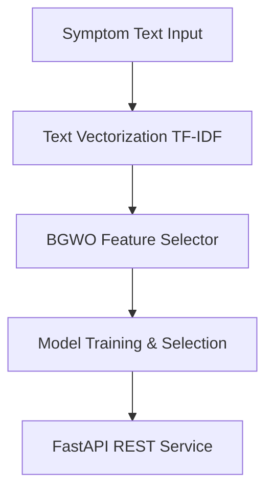

# ML-Based Communicable Disease Prediction System (BGWO Feature Selection)

An end-to-end Machine Learning research system that predicts communicable diseases from patient symptoms. It performs feature selection using **Binary Gray Wolf Optimization (BGWO)** to choose the most discriminative symptoms before training.

---

## 🔬 Core System Architecture



### 1. Data Preprocessing & Vectorization
- Text descriptions of symptoms are cleaned (lowercased, special characters removed).
- Text features are converted to numeric dimensions using **TF-IDF Vectorization** (term frequency-inverse document frequency).

### 2. Feature Selection: Binary Gray Wolf Optimization (BGWO)
To reduce noise and dimension sizes, the system implements a custom BGWO wrapper where:
- Each wolf is a binary vector: `1` = selected feature, `0` = excluded feature.
- **Fitness Function**:
  $$\text{fitness} = 0.7 \times F_1\text{-score} + 0.3 \times \left(1 - \frac{\text{selected features}}{\text{total features}}\right)$$
- The top three search agents are designates as Alpha ($\alpha$), Beta ($\beta$), and Delta ($\delta$) wolves.
- Binary positions are updated via continuous three-agent average mapped back to probabilities using a sigmoid transfer function:
  $$S(X_{\text{avg}}) = \frac{1}{1 + e^{-X_{\text{avg}}}}$$

### 3. ML Classifiers
The system trains and compares five classifiers using cross-validation:
- Decision Tree
- Random Forest
- Support Vector Machine (SVM)
- Naive Bayes
- XGBoost

The champion model is saved based on the highest weighted F1-score.

---

## 📁 Directory Structure

```text
ml-service/
├── data/
│   └── communicable_disease_dataset.csv
├── preprocessing/
│   ├── clean.py
│   ├── text_vectorizer.py
│   └── encoder.py
├── features/
│   ├── bgwo.py
│   └── feature_extraction.py
├── models/
│   ├── train_models.py
│   ├── evaluate.py
│   └── predict.py
├── model/
│   ├── best_model.pkl
│   ├── vectorizer.pkl
│   ├── selector.pkl
│   └── encoder.pkl
├── train.py
├── app.py
├── requirements.txt
└── README.md
```

---

## 🚀 Setup & Execution

### 1. Installation
Install the project dependencies in your environment:
```bash
pip install -r requirements.txt
```

### 2. Run the End-to-End Pipeline
Train all models, perform BGWO feature selection, compare metrics, and save the best model:
```bash
python train.py
```

### 3. Standalone CLI Prediction
Test predictions directly from your terminal using:
```bash
python models/predict.py "high fever, cough, body pain"
```

### 4. Run the REST API Server
Start the FastAPI server:
```bash
python app.py
```
Or use uvicorn:
```bash
uvicorn app:app --reload
```
Open your browser to [http://127.0.0.1:8000/docs](http://127.0.0.1:8000/docs) to view the interactive Swagger UI.

---

## ⚡ REST API Integration Example

### Request
`POST /predict`
```json
{
  "symptoms": "high fever, cough, body pain"
}
```

### Response
```json
{
  "disease": "Dengue",
  "confidence": 0.895,
  "important_symptoms": [
    "fever",
    "pain",
    "cough"
  ]
}
```
*Note: `important_symptoms` contains the active input features that were selected by BGWO, ranked by their global importance in the trained model (where supported).*
